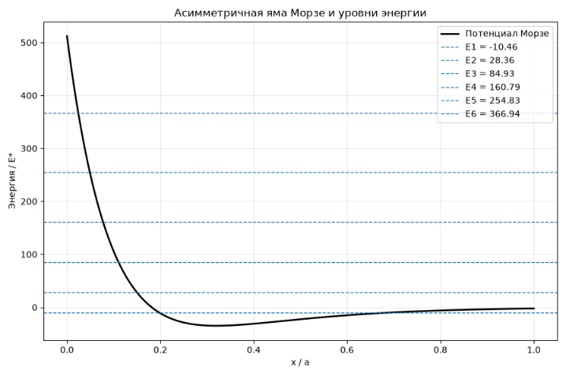
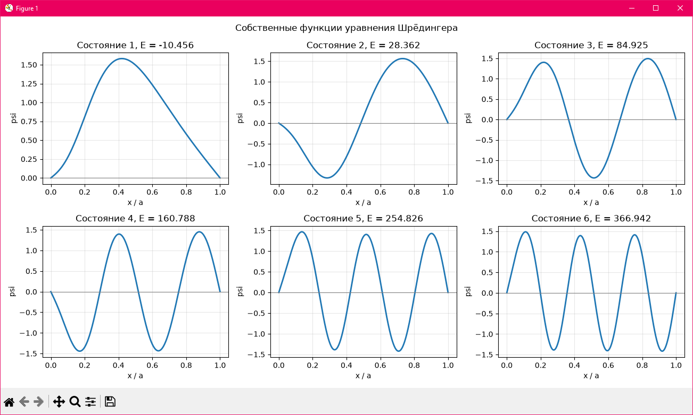
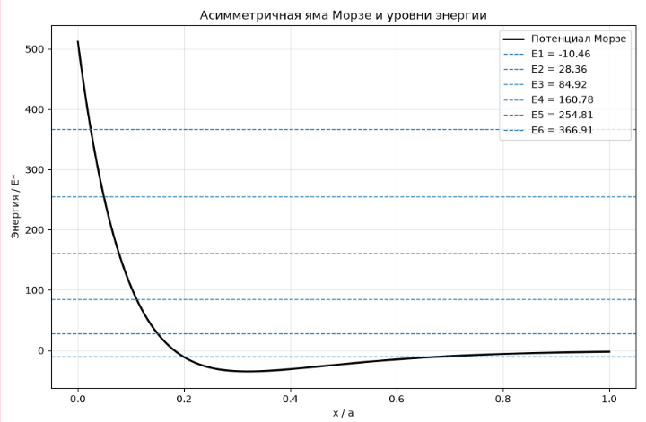
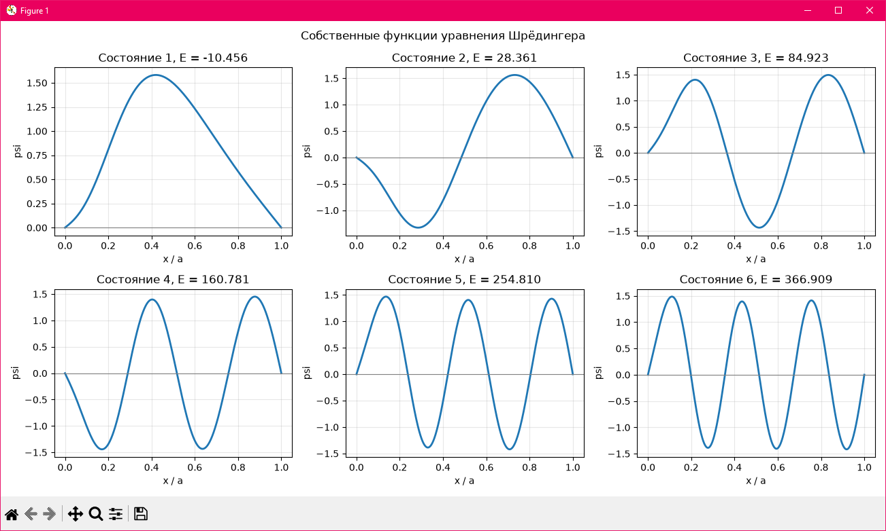
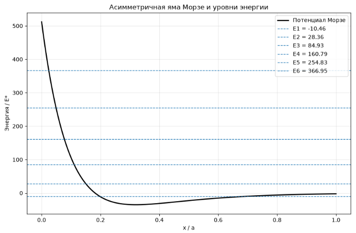

# Численное решение уравнения Шредингера для асимметричной потенциальной ямы Морзе

## Запуск программы

```bash
pip install -r requirements.txt
python main.py
```

## 1. Цель работы

Численно решить стационарное уравнение Шредингера для частицы в одномерной асимметричной потенциальной яме Морзе.

Найти первые шесть собственных значений энергии и соответствующие собственные функции, построить их графики, проверить нормировку волновых функций и исследовать сходимость численного метода при изменении количества точек сетки.

## 2. Постановка задачи

Рассматривается частица массой $m$, находящаяся в потенциальной яме на интервале $0 \le x \le a$, где $a$ - ширина ямы.

Внутри интервала потенциал задается аналитической функцией:

$$
U(x)=35E_*\left[\left(1-e^{-5(x/a-0.32)}\right)^2-1\right],
$$

где

$$
E_*=\frac{\hbar^2}{2ma^2}
$$

- характерная единица энергии.

Выбранный потенциал представляет собой асимметричную яму Морзе. Его минимум расположен в точке $x/a=0.32$ и равен $-35E_*$.

Слева потенциал быстро возрастает, образуя крутую стенку, а справа плавно приближается к нулю. Параметры 35, 5 и 0.32 определяют глубину, крутизну и положение минимума выбранной модели.

На границах интервала приняты условия:

$$
\psi(0)=0,\qquad \psi(a)=0.
$$

Они соответствуют бесконечно высоким потенциальным стенкам за пределами рассматриваемого интервала.

Стационарное уравнение Шредингера имеет вид:

$$
-\frac{\hbar^2}{2m}\frac{d^2\psi}{dx^2}
+U(x)\psi=E\psi.
$$

Введем безразмерную координату и энергию:

$$
\xi=\frac{x}{a},\qquad \varepsilon=\frac{E}{E_*}.
$$

Тогда уравнение принимает вид:

$$
-\frac{d^2\psi}{d\xi^2}+v(\xi)\psi
=\varepsilon\psi,
$$

где безразмерный потенциал:

$$
v(\xi)=35\left[\left(1-e^{-5(\xi-0.32)}\right)^2-1\right].
$$

Граничные условия:

$$
\psi(0)=\psi(1)=0.
$$

Таким образом, задача сводится к поиску собственных значений и собственных функций одномерного оператора Гамильтона.

## 3. Численный метод решения

Для решения используется метод конечных разностей.

Интервал $[0,1]$ разбивается на равномерную сетку с $N$ внутренними точками.

Шаг сетки:

$$
h=\frac{1}{N+1}.
$$

Вторая производная аппроксимируется центральной разностной формулой:

$$
\psi''(\xi_i)\approx
\frac{\psi_{i+1}-2\psi_i+\psi_{i-1}}{h^2}.
$$

Подставляя выражение в уравнение Шредингера, получаем:

$$
-\frac{\psi_{i+1}-2\psi_i+\psi_{i-1}}{h^2}
+v(\xi_i)\psi_i
=\varepsilon\psi_i.
$$

В матричной форме:

$$
H\boldsymbol{\psi}=\varepsilon\boldsymbol{\psi}.
$$

Матрица Гамильтона $H$ является симметричной трехдиагональной матрицей размерности $N\times N$.

Ее элементы:

$$
H_{ii}=\frac{2}{h^2}+v(\xi_i),
$$

$$
H_{i,i+1}=H_{i+1,i}=-\frac{1}{h^2}.
$$

Остальные элементы равны нулю.

Собственные значения матрицы соответствуют безразмерным энергиям частицы, а собственные векторы - дискретным значениям ее волновых функций.

Расчеты проведены с использованием Python, библиотек NumPy и SciPy. Для визуализации результатов применяется Matplotlib.

Основной расчет выполнен при $N=1000$. Дополнительно использованы сетки из 500 и 2000 внутренних точек для проверки сходимости.

## 4. Результаты расчетов

### 4.1. Собственные значения энергии

При $N=1000$ получены первые шесть собственных значений:

| Состояние | $E_n/E_*$ |
|---|---:|
| 1 | -10.456309 |
| 2 | 28.361603 |
| 3 | 84.925454 |
| 4 | 160.788355 |
| 5 | 254.826312 |
| 6 | 366.942221 |

С увеличением номера состояния энергия возрастает.

Первый уровень имеет отрицательную энергию, остальные пять уровней - положительную.

Поскольку используются бесконечно высокие стенки на границах интервала, все найденные состояния принадлежат дискретному спектру и являются связанными состояниями системы.

### 4.2. График потенциальной ямы



Асимметричная потенциальная яма Морзе и первые шесть энергетических уровней при N = 1000.

Черная линия показывает зависимость потенциальной энергии от безразмерной координаты $x/a$. Синими пунктирными линиями обозначены найденные уровни энергии.

Минимум потенциальной энергии равен $-35E_*$ и расположен при $x/a=0.32$.

График демонстрирует выраженную асимметрию потенциала.

### 4.3. Собственные волновые функции



Первые шесть собственных волновых функций уравнения Шредингера при N = 1000.

Полученные функции удовлетворяют заданным граничным условиям.

Количество внутренних узлов, то есть точек, в которых волновая функция обращается в нуль внутри интервала, последовательно увеличивается:

| Состояние | Число внутренних узлов |
|---|---:|
| $\psi_1$ | 0 |
| $\psi_2$ | 1 |
| $\psi_3$ | 2 |
| $\psi_4$ | 3 |
| $\psi_5$ | 4 |
| $\psi_6$ | 5 |

Это соответствует свойствам собственных функций одномерного уравнения Шредингера.

Для первого состояния максимум волновой функции смещен относительно центра интервала вследствие асимметрии потенциала.

С увеличением номера состояния количество осцилляций волновой функции возрастает.

## 5. Проверка сходимости численного метода

Для оценки точности расчетов собственные значения вычислены при трех размерах сетки:

- $N=500$;
- $N=1000$;
- $N=2000$.

Результаты сравнения:

| Уровень | N = 500 | N = 1000 | N = 2000 |
|---|---:|---:|---:|
| E1 | -10.456398 | -10.456309 | -10.456287 |
| E2 | 28.361079 | 28.361603 | 28.361735 |
| E3 | 84.923075 | 84.925454 | 84.926050 |
| E4 | 160.781346 | 160.788355 | 160.790111 |
| E5 | 254.810004 | 254.826312 | 254.830399 |
| E6 | 366.909426 | 366.942221 | 366.950439 |

Все значения приведены в единицах $E_*$.

При увеличении количества точек сетки изменение собственных значений уменьшается.

Например, для первого уровня:

$$
|E_1^{(500)}-E_1^{(1000)}|
=0.000089E_*,
$$

$$
|E_1^{(1000)}-E_1^{(2000)}|
=0.000022E_*.
$$

Разность уменьшается примерно в четыре раза при удвоении количества точек сетки, что соответствует ожидаемой сходимости второго порядка для центральной разностной аппроксимации.

Для шестого уровня также наблюдается сходимость:

$$
|E_6^{(1000)}-E_6^{(2000)}|
=0.008218E_*.
$$

Относительное изменение составляет около $0.0022\%$.

Таким образом, результаты устойчивы при уменьшении шага сетки.

Графики потенциальной ямы и собственных функций для $N=500$ и $N=2000$ приведены в приложении для сравнения.

## 6. Проверка нормировки собственных функций

Волновые функции должны удовлетворять условию нормировки:

$$
\int_0^1|\psi_n(\xi)|^2\,d\xi=1.
$$

В дискретном виде нормировка приближенно вычисляется по формуле:

$$
h\sum_{i=1}^{N}|\psi_n(\xi_i)|^2=1.
$$

Полученные результаты проверки:

| Волновая функция | Интеграл |
|---|---:|
| $\psi_1$ | 1.000000 |
| $\psi_2$ | 1.000000 |
| $\psi_3$ | 1.000000 |
| $\psi_4$ | 1.000000 |
| $\psi_5$ | 1.000000 |
| $\psi_6$ | 1.000000 |

Все шесть функций удовлетворяют условию нормировки с точностью до шести знаков после запятой.

Это позволяет интерпретировать квадрат модуля каждой нормированной функции как плотность вероятности в безразмерной координате.

## 7. Анализ результатов

Численное решение показывает, что форма потенциальной ямы существенно влияет на распределение собственных функций и значения энергетических уровней.

Асимметричный потенциал Морзе приводит к смещению распределения вероятности относительно центра интервала, особенно заметному для нижних энергетических состояний.

По мере роста энергии увеличивается количество узлов собственных функций.

Найденные уровни энергии не являются равноотстоящими. Это связано с неоднородной формой потенциала и выбранными граничными условиями.

В рассматриваемой постановке все состояния связаны, поскольку частица ограничена бесконечными стенками при $x=0$ и $x=a$.

При этом только первое состояние имеет отрицательную энергию относительно нулевого уровня потенциала Морзе.

Для потенциала Морзе без бесконечных граничных стенок число связанных состояний и их энергии были бы другими.

## 8. Вывод

В ходе работы численно решено стационарное уравнение Шредингера для частицы в одномерной асимметричной потенциальной яме Морзе.

Метод конечных разностей позволил преобразовать дифференциальное уравнение в матричную задачу на собственные значения.

Найдены первые шесть энергетических уровней и соответствующие собственные волновые функции. Построены графики потенциала и собственных функций.

Проверка при 500, 1000 и 2000 внутренних точках показала сходимость собственных значений при уменьшении шага сетки.

Проверка нормировки подтвердила выполнение условия единичного интеграла квадрата модуля для всех шести вычисленных функций.

Полученные результаты демонстрируют применимость метода конечных разностей к решению одномерного уравнения Шредингера с аналитически заданным асимметричным потенциалом.

## Графики для разных размеров сетки

### А.1. Результаты при N = 500



Асимметричная потенциальная яма Морзе и первые шесть энергетических уровней при N = 500.



Первые шесть собственных волновых функций уравнения Шредингера при N = 500.

### А.2. Результаты при N = 2000



Асимметричная потенциальная яма Морзе и первые шесть энергетических уровней при N = 2000.


Первые шесть собственных волновых функций уравнения Шредингера при N = 2000.

### А.3. Сравнение результатов

Сравнение рисунков 2, 4 и 6 показывает, что форма собственных функций практически не изменяется при увеличении количества точек сетки.

Это дополнительно подтверждает устойчивость численного решения.
